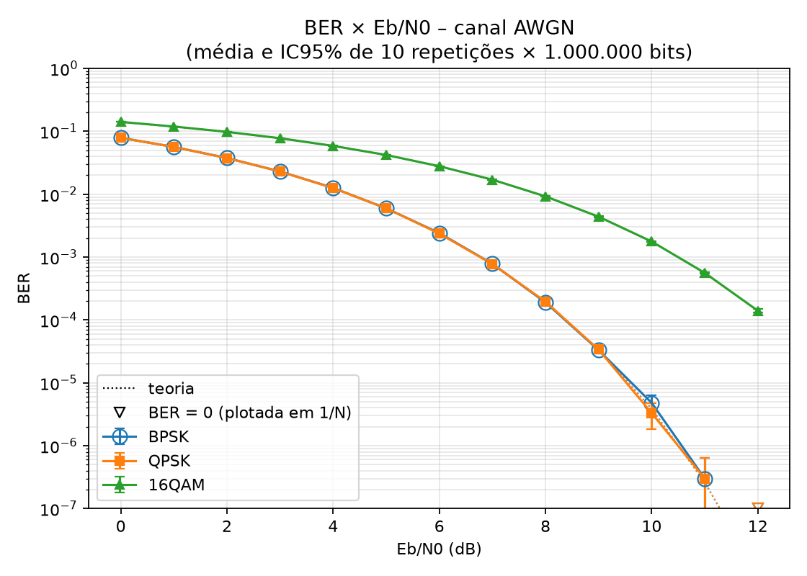
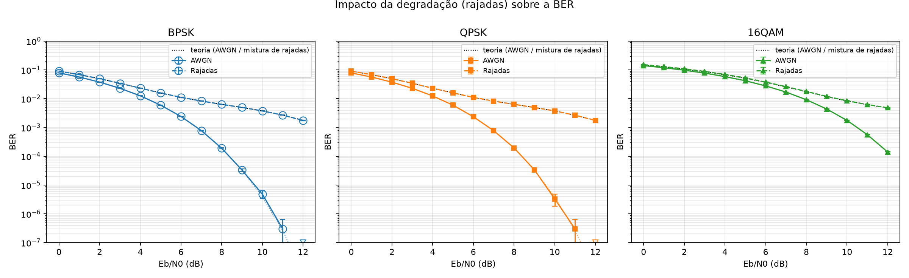
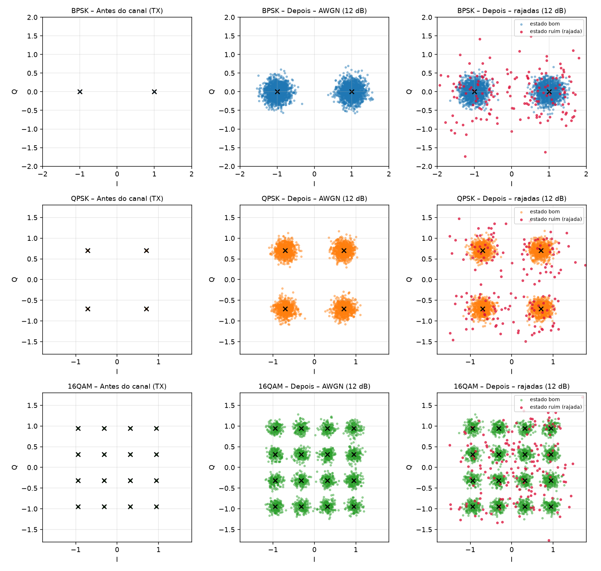
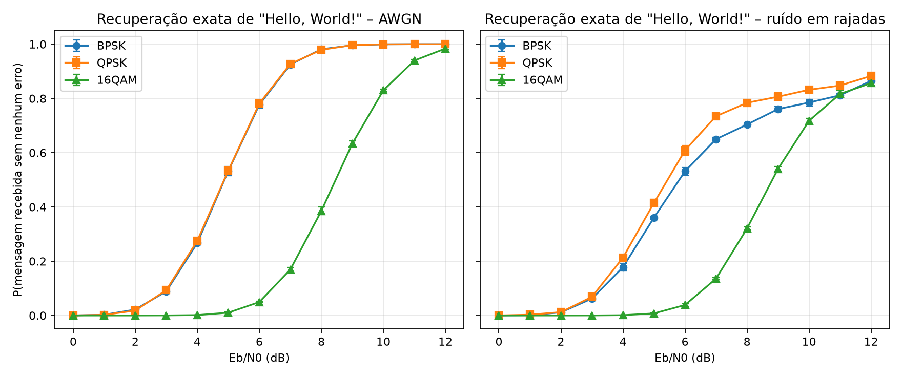
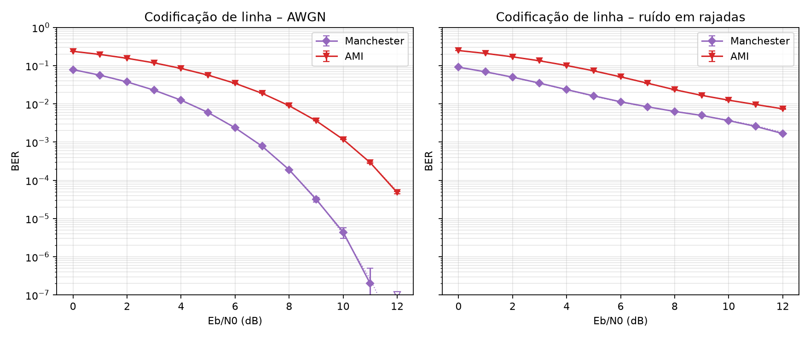
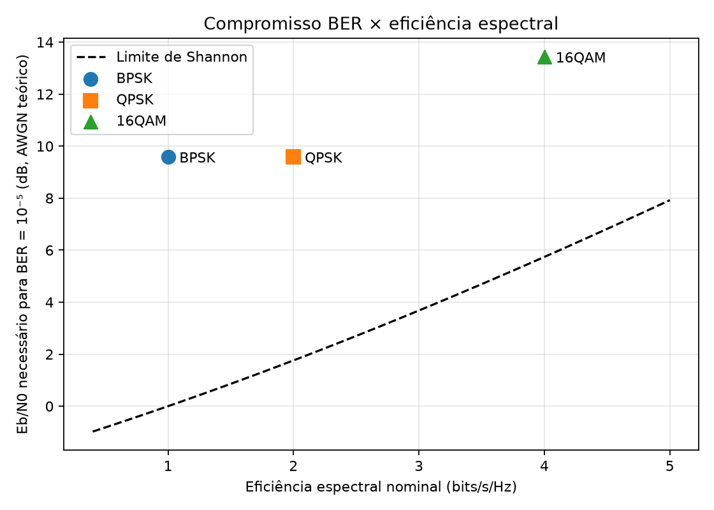

# GBRedesII – Simulador de transmissão digital (codificação de linha + modulação)

Trabalho II de Redes de Computadores – UNISINOS (Prof. Cristiano Bonato Both).
Simulador ponta a ponta em Python: **mensagem ASCII → bits → codificação de linha → modulação → canal ruidoso → demodulação → decodificação → mensagem**, com cálculo de BER e eficiência espectral e um plano experimental reproduzível.

- **Dupla:** Arthur Alves Pasini e Eduardo Godoi
- **Vídeo (≤ 5 min):** 

---

## 1. Como instalar e executar

```bash
pip install -r requirements.txt        # numpy, scipy, pandas, matplotlib, pytest

python main.py demo            # enlace completo com a mensagem, mostrando bits errados  -> resultados/demo.txt
python main.py consistencia    # teste de consistência (canal ideal e SNR alta)           -> resultados/consistencia.txt
python main.py experimentos    # varreduras de Eb/N0 (≈ 1 min)                            -> resultados/*.csv
python main.py graficos        # figuras + tabela de compromisso a partir dos CSVs        -> resultados/figuras/, tabela_compromisso.*
python main.py tudo            # todos os passos acima
python -m pytest -q tests      # testes unitários (9 testes)
```
`--rapido` usa uma configuração reduzida (100 mil bits) só para testar; **os resultados entregues foram gerados sem ele.**
Todos os parâmetros estão em `config.py` e são gravados em `resultados/config_usada.json`.

## 2. Arquitetura

```
main.py                    CLI (demo | consistencia | experimentos | graficos | tudo)
config.py                  parâmetros dos experimentos (seed, SNRs, nº de bits, repetições, canal de rajadas)
utils/
  textUtils.py             texto <-> códigos ASCII <-> bits
  codificacaoUtils.py      codificação de linha: Manchester e AMI (+ decodificadores)
  modulacaoUtils.py        BPSK, QPSK, 16-QAM (Gray, Es=1) e demoduladores por mínima distância
  canalUtils.py            AWGN com controle de Eb/N0 e canal de rajadas (Gilbert-Elliott)
  metricasUtils.py         BER, eficiência espectral nominal, curvas teóricas, limite de Shannon
  experimentoUtils.py      enlace ponta a ponta, varreduras, agregação estatística, tabela de compromisso
  graphUtils.py            todos os gráficos
tests/test_simulador.py    testes unitários
resultados/                CSVs brutos/agregados, figuras, tabela, logs de demo e consistência
```

```
bits ─► [Manchester*] ─► Modulador (BPSK|QPSK|16QAM) ─► CANAL (AWGN | rajadas) ─► Demodulador ─► [decod. Manchester*] ─► bits ─► texto
                                                                                                         (* opcional)
bits ─► AMI | Manchester (níveis) ─► CANAL ─► decisão ─► bits           (experimento de codificação de linha em banda base)
```

### Codificação de linha × codificação de correção de erros
- **Linha** (Manchester, AMI): define *como os bits viram níveis de sinal* no meio físico – sincronismo (transições), ausência de componente DC, detecção de violações. Não adiciona proteção algébrica e **não corrige** erros.
- **Correção de erros / FEC** (Hamming, Reed-Solomon, convolucional…): acrescenta bits redundantes calculados a partir dos dados, permitindo detectar *e corrigir* erros. **Não foi usada** aqui (BER medida = BER do canal + modulação).
- Implementadas: **Manchester** (1 → +1,−1; 0 → −1,+1; 2 amostras/bit) e **AMI** (0 → 0; cada 1 alterna +1/−1). Na AMI, dois pulsos seguidos de mesma polaridade são uma *violação bipolar* (erro detectado); no Manchester, chips iguais (`00`/`11`) também indicam erro detectado.
- Como AMI é ternário, ele **não** alimenta o modulador binário; é avaliado em banda base. O Manchester funciona nos dois modos (banda base e como chips binários antes da modulação).

### Modulações (mapeamento Gray, energia média por símbolo Es = 1)
| Modulação | bits/símbolo | observação |
|---|---|---|
| BPSK | 1 | ±1 |
| QPSK | 2 | (±1 ± j)/√2 |
| 16-QAM (ordem superior) | 4 | níveis {±1, ±3}/√10 por eixo, Gray por eixo |

Demodulação por decisão rígida (distância mínima). Quando o nº de bits não é múltiplo de bits/símbolo, o transmissor completa com zeros e o receptor descarta o excesso.

### Definição de SNR
Todo o trabalho usa **Eb/N0 (dB)** (energia por *bit* / densidade espectral de ruído), a métrica que permite comparar modulações de ordens diferentes de forma justa. Relação: `Es/N0 = Eb/N0 + 10·log10(bits/símbolo)`. Ruído gaussiano com variância `N0/2` por dimensão real.

### Cenários de canal
1. **AWGN** com Eb/N0 controlado.
2. **Ruído em rajadas** (modelo de Gilbert-Elliott, cadeia de Markov de 2 estados): estado *bom* = AWGN com o Eb/N0 nominal; estado *ruim* = ruído **10 dB mais forte**. `P(bom→ruim)=0,005`, `P(ruim→bom)=0,10` ⇒ rajada média de 10 símbolos e canal no estado ruim ≈ 4,76 % do tempo (potência média de ruído ×1,43 ≈ +1,55 dB). Comparação com o AWGN é feita **no mesmo Eb/N0 nominal**.

### Eficiência espectral nominal
`η = log2(M)/(1+α)`; com filtro de Nyquist ideal (α = 0): **BPSK 1, QPSK 2, 16-QAM 4 bits/s/Hz** (sem FEC). Para a linha (banda até o 1º nulo, pulso retangular): AMI 1, Manchester 0,5 bit/s/Hz (o Manchester dobra a banda).

## 3. Plano experimental

| Item | Valor |
|---|---|
| Eb/N0 | 0, 1, …, 12 dB (**13 valores**) |
| Bits por ponto | **1.000.000** por (esquema, canal, Eb/N0, repetição) |
| Repetições | **10** sementes independentes (≥ 5 exigido) ⇒ 10⁷ bits por ponto |
| Esquemas | BPSK, QPSK, 16-QAM; Manchester, AMI |
| Canais | AWGN e rajadas |
| Pareamento | em cada repetição, **os mesmos bits** são usados em todas as modulações/SNRs; o ruído usa semente própria `[seed, canal, esquema, snr, rep]` (gravada em `resultados_brutos.csv`) |
| Variabilidade | média, desvio, **IC95 % (t de Student, n=10)**, mín/máx |
| Mensagem | `"Hello, World!"` (104 bits) enviada 2000× por ponto × 5 repetições |
| Total simulado | ≈ 7,8·10⁸ bits nas varreduras |

**Justificativa do tamanho de amostra:** com 10⁷ bits por ponto, mede-se BER até ~10⁻⁶ com ≥ 10 erros. Pontos com 0 erros são plotados em `1/N` (triângulo vazado = limite superior).

Arquivos: `resultados_brutos.csv` (1 linha por execução), `resultados_agregados.csv`, `mensagem_bruto.csv`, `mensagem_agregado.csv`, `tabela_compromisso.{csv,md}`, `config_usada.json`.
**Reprodução:** `python main.py experimentos && python main.py graficos` regenera tudo (semente fixa `20261119` ⇒ resultados idênticos).

## 4. Resultados

### 4.1 Validação funcional (teste de consistência) – `resultados/consistencia.txt`
Mensagem `"Hello, World!"`, todas as modulações (com e sem Manchester) + AMI/Manchester em banda base: em **canal ideal** e em **Eb/N0 = 30 dB** (AWGN e rajadas, 1000 repetições) a recuperação foi **exata em 100 % dos casos, 0 bits errados**. Divergências possíveis e por quê: (i) preenchimento de bits (16-QAM/QPSK); (ii) em SNR alto o erro não é *zero*, é desprezível (BER teórica do 16-QAM a 30 dB ≈ 10⁻¹⁷⁶); (iii) mesmo em rajada, 30−10 = 20 dB ainda é muito alto.
A demonstração com bits errados identificados (posições e texto recebido) está em `resultados/demo.txt`.

### 4.2 BER × Eb/N0 em AWGN – `figuras/fig1_ber_awgn.png`

A simulação coincide com a teoria (razão simulado/teórico entre **0,93 e 1,04** nos 121 pontos com estatística suficiente; a teoria do 16-QAM é a aproximação de 1ª ordem). **BPSK e QPSK têm BER idêntica** em função de Eb/N0 (QPSK = dois BPSK em quadratura, com Gray), mas o QPSK usa metade da banda. O 16-QAM exige ≈ **+3,7 dB** (1e-3: 6,78 → 10,49 dB; 1e-5 teórico: 9,59 → 13,43 dB).

### 4.3 AWGN × rajadas – `figuras/fig2_ber_rajadas.png`, `fig3_awgn_vs_rajadas.png`

- A degradação cria um **piso de erro**: a BER deixa de cair rapidamente com o Eb/N0, pois ela passa a ser dominada pelo estado ruim (≈ 4,8 % do tempo com SNR efetivo 10 dB menor). BPSK a 8 dB: 1,9·10⁻⁴ (AWGN) → 6,4·10⁻³ (rajadas), **≈ 33× pior**; a 12 dB, ≈ 10⁻⁸ → 1,7·10⁻³.
- Para BER = 10⁻², o BPSK precisa de 4,31 dB em AWGN e 6,37 dB com rajadas (+2,1 dB); o 16-QAM, 7,87 → 9,53 dB. Para 10⁻³ o canal de rajadas **não atinge** a meta até 12 dB.
- A curva de rajadas segue a mistura teórica `(1−π)·BER(γ) + π·BER(γ−10 dB)` (tracejada preta), validando o modelo de canal.
- Constelações (`fig5_constelacoes.png`): na rajada, os pontos vermelhos (estado ruim) são os que escapam das regiões de decisão.



### 4.4 Recuperação da mensagem – `figuras/fig6_recuperacao_mensagem.png`

Probabilidade de receber `"Hello, World!"` **sem nenhum erro** (média de 5 × 2000 envios):

| Eb/N0 | BPSK AWGN | BPSK rajadas | 16-QAM AWGN | 16-QAM rajadas |
|---|---|---|---|---|
| 8 dB | 98,2 % | 70,4 % | 38,5 % | 32,0 % |
| 12 dB | 100 % | 86,5 % | 98,4 % | 85,6 % |

Em AWGN a recuperação satura em 100 % assim que a BER cai; com rajadas ela **estaciona em ~85 %** mesmo em 12 dB: erros em rajada atingem poucas mensagens, mas atingem de forma "tudo-ou-nada", e aumentar a potência ajuda pouco. (O 16-QAM se aproxima do BPSK em rajadas provavelmente porque a mensagem ocupa 4× menos símbolos e, portanto, tem menor chance de ser atingida por uma rajada – hipótese não testada separadamente.)

### 4.5 Codificação de linha – `figuras/fig4_codificacao_linha.png`, `fig8_formas_de_onda_linha.png`

Com decisão ótima, o **Manchester tem a mesma BER do BPSK** (`Q(√(2·Eb/N0))`). A **AMI** com limiar de magnitude é pior (a 8 dB: 9,0·10⁻³ vs 1,9·10⁻⁴; ≈ 4–5 dB), porque metade dos bits tem energia nula e o limiar é sensível ao ruído (teoria `1,5·Q(√γ) − 0,5·Q(3√γ)`, confirmada). Em compensação: AMI ocupa **metade da banda** do Manchester (1 vs 0,5 bit/s/Hz), não tem componente DC e permite detectar erros por violação bipolar; o Manchester garante transição a cada bit (sincronismo) mas dobra a banda.

### 4.6 Compromisso BER × eficiência espectral – `resultados/tabela_compromisso.md`, `fig7_compromisso_ber_eficiencia.png`


| Modulação | η nominal (bits/s/Hz) | Eb/N0 p/ BER 10⁻³ (AWGN) | Eb/N0 p/ BER 10⁻⁵ (teórico) | BER @8 dB AWGN | BER @8 dB rajadas |
|---|---|---|---|---|---|
| BPSK | 1 | 6,78 dB | 9,59 dB | 1,9·10⁻⁴ | 6,4·10⁻³ |
| QPSK | 2 | 6,77 dB | 9,59 dB | 1,95·10⁻⁴ | 6,4·10⁻³ |
| 16-QAM | 4 | 10,49 dB | 13,43 dB | 9,2·10⁻³ | 1,8·10⁻² |

**Quando cada uma é mais adequada**
- **QPSK**: melhor "ponto de equilíbrio" – mesma robustez (Eb/N0) do BPSK com o dobro da eficiência espectral; escolha padrão quando há SNR moderado.
- **BPSK**: só se justifica quando o SNR por símbolo é muito baixo (enlaces no limite, ex.: longa distância), ou quando se quer máxima simplicidade/robustez de fase e a banda não é restrição.
- **16-QAM**: quando a **banda é o recurso escasso** e há SNR alto e estável (≳ 13 dB de Eb/N0 para 10⁻⁵); custa ≈ 3,8 dB a mais para 4× a eficiência. É a mais vulnerável a rajadas (constelação densa) – nesse caso exige FEC/intercalamento ou adaptação dinâmica (AMC).
- Em canal com rajadas, aumentar a potência dá retorno decrescente: o caminho é **codificação de canal + intercalamento** (fora do escopo deste trabalho). Todos os pontos permanecem acima do limite de Shannon (fig. 7).

## 5. Limitações
- Decisão rígida; sem sincronismo, filtragem de pulso/ISI, fading nem FEC (canal em banda base equivalente, símbolos amostrados).
- Eficiência espectral **nominal** (Nyquist ideal, α = 0); com roll-off real, η = log2(M)/(1+α).
- Na demonstração, "Manchester + modulação" usa Eb/N0 por bit *transmitido* (chip); contado por bit de informação, haveria 3 dB de perda.
- A BER teórica do 16-QAM é aproximação; a do canal de rajadas assume estados independentes por símbolo.

## 6. Divisão de responsabilidades da dupla  ← **ajustar conforme o que cada um fez**
| Integrante | Responsabilidades |
|---|---|
| _[Nome 1]_ | geração de dados/ASCII, codificação de linha (Manchester, AMI), canal (AWGN e rajadas), teste de consistência |
| _[Nome 2]_ | modulações (BPSK, QPSK, 16-QAM) e demodulação, métricas (BER, η, teoria), experimentos e gráficos |
| Ambos | análise dos resultados, README, vídeo e apresentação (cada um fala em ~5 min) |
